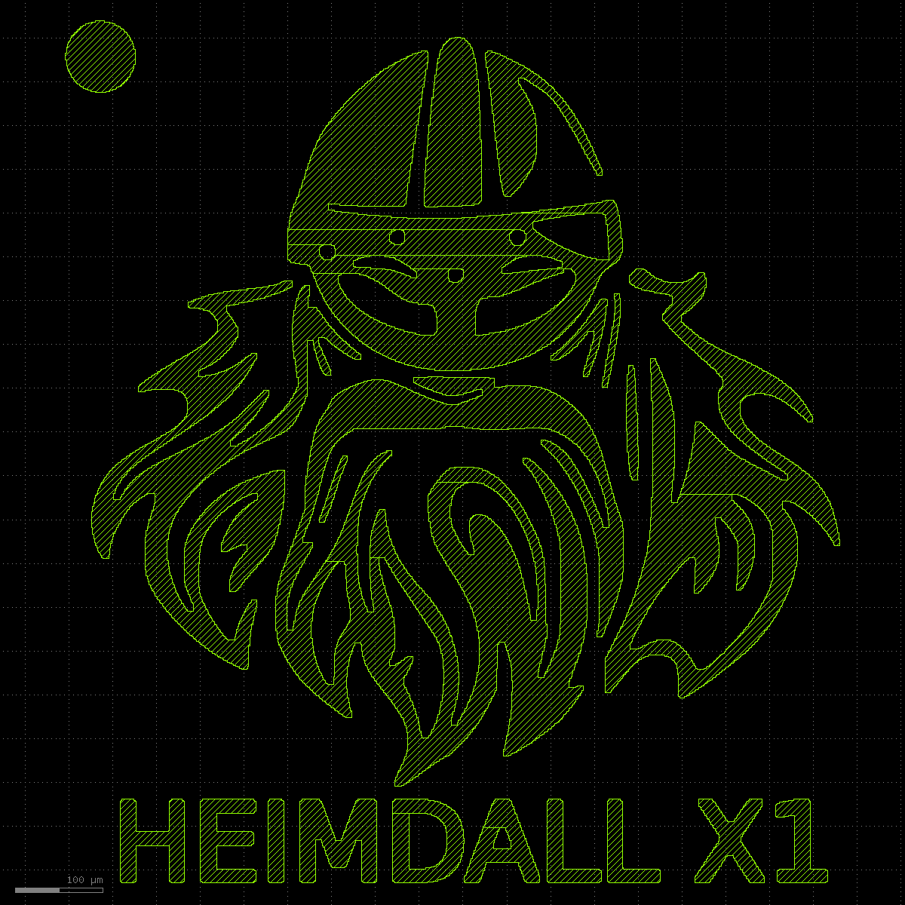

# heimdall — HT13G-M open RFIC

**heimdall** is the repository for **HT13G-M**, an open RFIC on **IHP SG13G2** (130 nm SiGe BiCMOS). The chip targets 130–175 MHz and 400–480 MHz, pin-compatible with the Semtech SX1255 for repeater modules and the LinHT handheld (LinHT is read-only context; this repo never clones or pushes LinHT).

Chip art cell text remains **HEIMDALL X1** for this migration (repo name is heimdall).

## Chip art

Standalone TopMetal2 cell (not placed on the die until Phase 5). Art text on the die is **HEIMDALL X1** (repo name: heimdall).

| Art raster (from outlines) | GDS TopMetal2 render |
|---|---|
|  |  |

Source: [`graphic/graphic.svg`](graphic/graphic.svg), outlines [`graphic/graphic_outlines.svg`](graphic/graphic_outlines.svg). Build: `analog/chipart/build_art.py`. Spec: `spec/chip-art.md`.

## Status

Phase 0–1 digital back end signed off. Phase 2 LO/VCO/PLL in progress: P2.0–P2.6 accepted; **P2.7.2c** tank PEX + fixed-C trim accepted (cfix 157.7 fF, margins 102/93 MHz [SCH]). Next: direct bank–core re-pack and join, then P2.7.3 VCO PEX. Live decision log: `decisions.md`. Handoff and reproduce steps: `docs/HANDOFF.md`.

Nothing in this repository has been submitted for fabrication.

## System / repeater context

The multiband repeater system, PCB, and module work live in **[SDR-repeater](https://github.com/Supermagnum/SDR-repeater)**. Shared specs:

| File | Master | Snapshot |
|---|---|---|
| `spec/derived-limits.md` | this repo | SDR-repeater |
| `spec/baseline-decisions.md` | this repo | SDR-repeater |
| `spec/rf-frontend.md` | SDR-repeater | this repo (read-only) |

## Reproduce (pinned tools)

Container `hpretl/iic-osic-tools:2026.10`, PDK commit `a49358cc`.

```bash
cd heimdall
docker run -it --rm -v "$PWD":/foss/designs \
  hpretl/iic-osic-tools:2026.10 --skip bash
# inside:
iic-pdk ihp-sg13g2
```

See `docs/HANDOFF.md` for LibreLane, cocotb, DRC/LVS, and sign-off commands.

## License

GPL-3.0 — see `LICENSE`.
